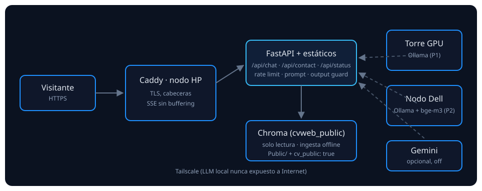

# Rafita — portfolio con segundo cerebro de IA self-hosted

[](https://github.com/rufae/CV-Web/actions/workflows/backend.yml)
[](https://github.com/rufae/CV-Web/actions/workflows/frontend.yml)

Portfolio personal (React + FastAPI) cuyo asistente es **Rafita**, el segundo
cerebro de Rafael: **RAG sobre un vault Obsidian público**, enrutado de LLM
entre nodos propios (`gemma4:12b`: torre GPU → nodo Dell) y despliegue
self-hosted en un nodo HP. El objetivo es demostrar ingeniería de IA aplicada:
recuperación con umbrales calibrados, guardarraíles contra inyección y fuga de
datos, evaluación reproducible y operación con failover.

## Qué demuestra

- **RAG real**: extracción con allow-list (`Public/` + `cv_public: true`),
  redacción de datos sensibles, chunking Markdown, embeddings `bge-m3` y Chroma.
- **Router híbrido**: prioridad torre GPU → nodo Dell → Gemini opcional, con
  health checks con histéresis, circuit breaker y failover **solo antes del
  primer token**.
- **Seguridad**: sanitización, prompt endurecido con canario, output guard
  (fuga de prompt/PII/URLs), rate limit, presupuesto diario, contacto con
  honeypot/Turnstile y outbox con reintentos.
- **Evaluación**: dataset dorado (49 casos), `recall@5=0.983`,
  `refusal_recall=1.000`, 0 fugas (informe versionado en `eval/reports/`).
- **Operación**: releases con rollback, métricas Prometheus, health profundo,
  backups, runbook y escenarios de caos documentados.

## Arquitectura



nginx-proxy-manager o Caddy (TLS, cabeceras, SSE sin buffering) → FastAPI en el
nodo HP (estáticos + API + Chroma) → Ollama en la torre/Dell por Tailscale
(LLM nunca expuesto).

## Quickstart local

Los LLM viven en la tailnet (torre GPU y nodo Dell, ambos con
`gemma4:12b`); los embeddings, en el Dell (`bge-m3`). Para una demo sin depender de la tailnet puedes apuntar
`LLM_*`/`EMBED_*` a un Ollama local con los mismos modelos.

```bash
# Backend
cd backend
python3 -m venv .venv && .venv/bin/pip install --require-hashes -r requirements.lock
cp .env.example .env                 # revisa LLM_*, EMBED_* y VAULT_PATH
.venv/bin/uvicorn app.main:app --port 8010

# Ingesta de la bóveda pública (una vez). El repo incluye una sembrada en
# `deploy/public-vault/`; apunta VAULT_PATH a tu propia bóveda si la tienes:
cp -r ../deploy/public-vault/Public ../vault/ 2>/dev/null || true
.venv/bin/python scripts/ingest_public_vault.py --vault ../deploy/public-vault --rebuild

# Frontend (proxy /api → 127.0.0.1:8010 ya configurado)
cd ../frontend && npm ci && npm run dev   # http://localhost:5173
```

Tests: `cd backend && .venv/bin/pytest` · `cd frontend && npm run test` ·
E2E: `cd frontend && npm run test:e2e` · Evaluación:
`python eval/run_eval.py --retrieval-only` · Consistencia:
`python eval/check_consistency.py`.

## Despliegue

Docker multi-stage (frontend + backend en una imagen):

```bash
cp backend/.env.example .env         # secretos y configuración
docker compose up -d --build         # http://127.0.0.1:8086
```

En el nodo HP, nginx-proxy-manager publica `http://cv-web.home/` → `8086`.
Detalles y operación: [`docs/deployment-guide.md`](docs/deployment-guide.md).

## Estructura

```
Dockerfile     imagen multi-stage (frontend + backend)
compose.yaml   servicio cvweb en el nodo HP (8086)
backend/       FastAPI (app/), tests/, scripts/ (ingesta, facts), locks reproducibles
frontend/      React 19 + Vite 7 (features/, shared/, content/, e2e/)
eval/          dataset.jsonl, redteam.jsonl, run_eval.py, check_consistency.py, reports/
deploy/        systemd y Caddyfile (alternativa), deploy.sh (releases+rollback), backup.sh
docs/          architecture, deployment-guide, runbook, security, evaluation, ADRs
```

## Documentación

- [`docs/architecture.md`](docs/architecture.md) · [`docs/runbook.md`](docs/runbook.md)
- [`docs/security.md`](docs/security.md) · [`docs/evaluation.md`](docs/evaluation.md)
- [`docs/privacy.md`](docs/privacy.md) · [`docs/accessibility.md`](docs/accessibility.md)
- [`docs/resilience.md`](docs/resilience.md) · ADRs en [`docs/adr/`](docs/adr/)

## Licencia

Código bajo licencia MIT (ver [`LICENSE`](LICENSE)). El **contenido personal**
(CV en PDF, fotografía, textos del portfolio y `facts.json`) queda excluido de
la licencia y no puede reutilizarse.
